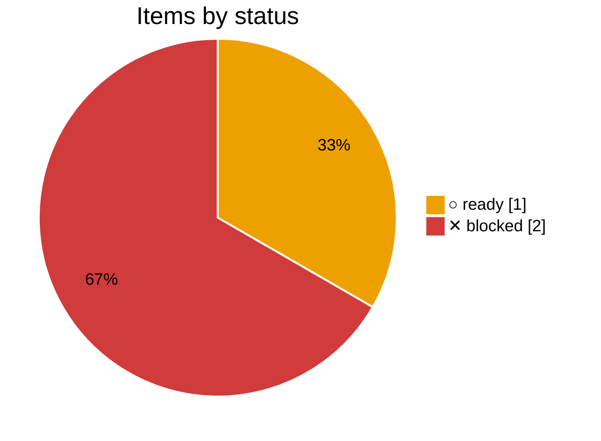

The pages people use. Starts once the backend is done.

<!-- pm:progress -->
**0% done** · ✓ 0 done · ▶ 0 active · ○ 1 ready · ✕ 2 blocked · [review](../progress/frontend.md)

<!-- /pm:progress -->
