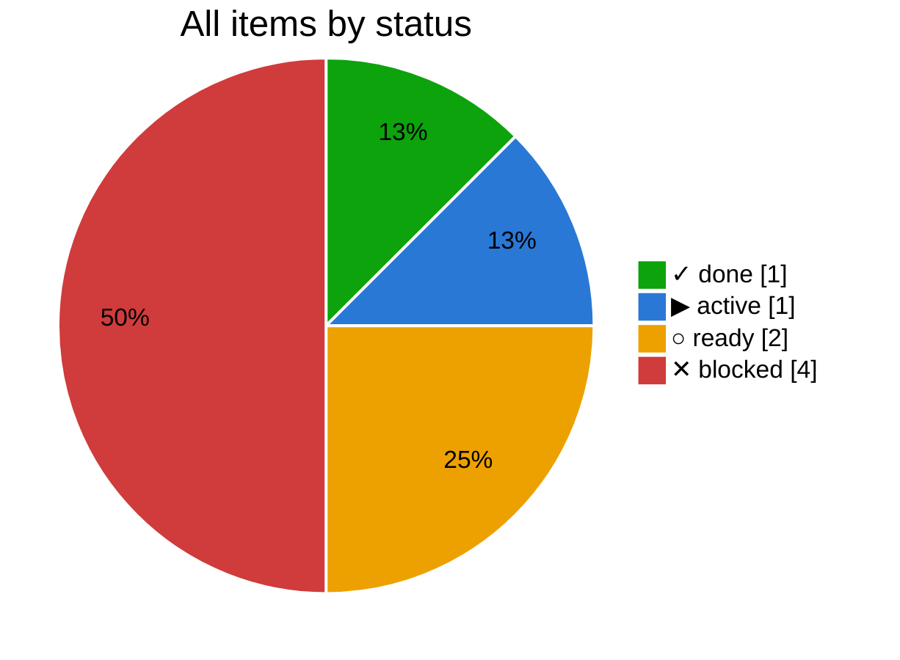
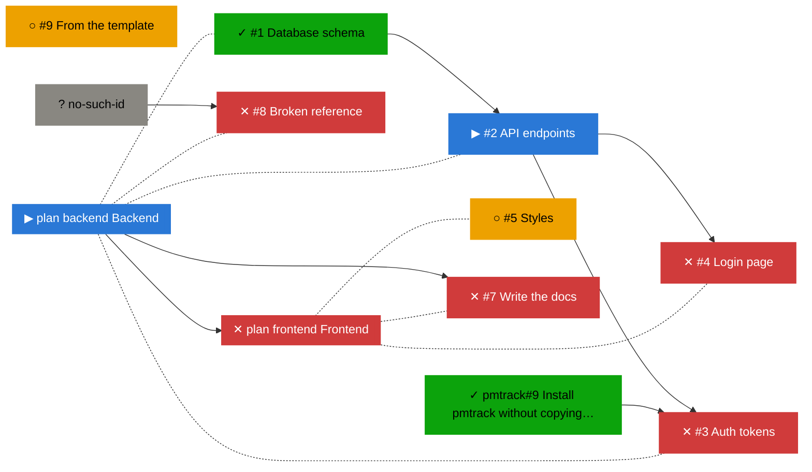

# Progress review

_Data as of 2026-10-23 03:44 UTC · changes compared with nothing yet · generated by pmtrack 0.1.2_

```mermaid
%%{init: {"themeVariables": {"xyChart": {"backgroundColor": "#ffffff", "titleColor": "#222222", "plotColorPalette": "#0ca30c,#ffffff", "xAxisLabelColor": "#222222", "xAxisTitleColor": "#222222", "xAxisTickColor": "#222222", "xAxisLineColor": "#222222", "yAxisLabelColor": "#222222", "yAxisTitleColor": "#222222", "yAxisTickColor": "#222222", "yAxisLineColor": "#222222"}}, "xyChart": {"height": 225}}}%%
xychart-beta horizontal
  title "% done by subset"
  x-axis ["all · 19%", "area/backend · 38%", "area/frontend · 0%"]
  y-axis "% done" 0 --> 100
  bar [19, 38, 0]
  bar [0, 0, 0]
```

| Subset | % done | ✓ done | ▶ active | ○ ready | ✕ blocked | Δ % pts |
|---|--:|--:|--:|--:|--:|--:|
| **all** | 19 | 1 | 1 | 2 | 4 | new |
| area/backend | 38 | 1 | 1 | 0 | 2 | new |
| area/frontend | 0 | 0 | 0 | 1 | 1 | new |

## Plans

```mermaid
%%{init: {"themeVariables": {"xyChart": {"backgroundColor": "#ffffff", "titleColor": "#222222", "plotColorPalette": "#0ca30c,#ffffff", "xAxisLabelColor": "#222222", "xAxisTitleColor": "#222222", "xAxisTickColor": "#222222", "xAxisLineColor": "#222222", "yAxisLabelColor": "#222222", "yAxisTitleColor": "#222222", "yAxisTickColor": "#222222", "yAxisLineColor": "#222222"}}, "xyChart": {"height": 180}}}%%
xychart-beta horizontal
  title "% done by plan"
  x-axis ["backend · 38%", "frontend · 0%"]
  y-axis "% done" 0 --> 100
  bar [38, 0]
  bar [0, 0]
```

| Plan | % done | ✓ | ▶ | ○ | ✕ | Review |
|---|--:|--:|--:|--:|--:|---|
| ▶ [Backend](../docs/backend.md) | 38 | 1 | 1 | 0 | 2 | [backend.md](backend.md) |
| ✕ [Frontend](../docs/frontend.md) | 0 | 0 | 0 | 1 | 2 | [frontend.md](frontend.md) |

## Changes

_No earlier snapshot yet; changes appear from the next update._

## Needs attention

### ✕ Blocked

- [#3](https://github.com/bvraghav/pm-dummy/issues/3) Auth tokens, waiting on ▶ [#2](https://github.com/bvraghav/pm-dummy/issues/2) API endpoints
- [#4](https://github.com/bvraghav/pm-dummy/issues/4) Login page, waiting on ▶ [#2](https://github.com/bvraghav/pm-dummy/issues/2) API endpoints
- [#7](https://github.com/bvraghav/pm-dummy/issues/7) Write the docs, waiting on ▶ [Backend](../docs/backend.md)
- [#8](https://github.com/bvraghav/pm-dummy/issues/8) Broken reference, waiting on ? `no-such-id` (unresolved)

### Metadata problems

- [#8](https://github.com/bvraghav/pm-dummy/issues/8) Broken reference: unresolved dependency `no-such-id`

## Next up

_Ready items, those that unblock the most first._

- ○ [#5](https://github.com/bvraghav/pm-dummy/issues/5) Styles
- ○ [#9](https://github.com/bvraghav/pm-dummy/issues/9) From the template

## Dependency graph

_Legend: ✓ done · ▶ active (assigned or partly ticked) · ○ ready (nothing it waits on is open) · ✕ blocked · arrows point from a dependency to what waits on it; dotted lines join a plan to its items._

## Trend

_The trend starts once there are two days of history._
