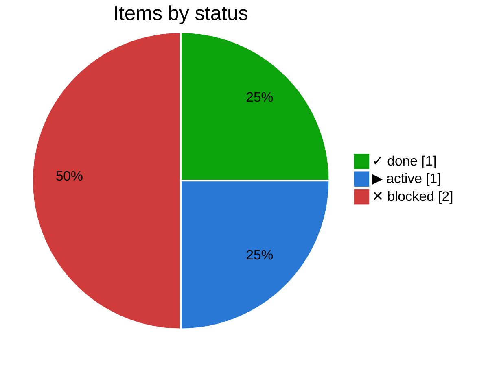
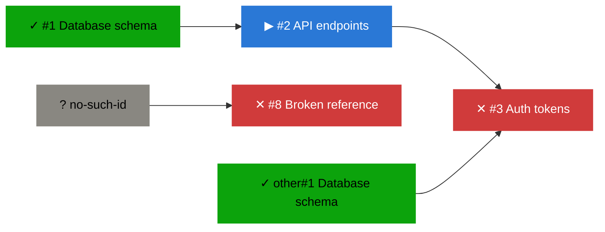

# ▶ Backend

_Plan `backend` · [doc](../docs/backend.md) · data as of 2026-10-23 04:12 UTC · [all subsets](README.md)_

**50% done** · ✓ 1 done · ▶ 1 active · ○ 0 ready · ✕ 2 blocked

| Item | Status | Ticked | Depends on |
|---|---|--:|---|
| [#1](https://github.com/bvraghav/pm-dummy/issues/1) Database schema | ✓ done | 2/2 |  |
| [#2](https://github.com/bvraghav/pm-dummy/issues/2) API endpoints | ▶ active | 2/2 | ✓ #1 |
| [#3](https://github.com/bvraghav/pm-dummy/issues/3) Auth tokens | ✕ blocked |  | ▶ #2, ✓ other#1 |
| [#8](https://github.com/bvraghav/pm-dummy/issues/8) Broken reference | ✕ blocked |  | ? `no-such-id` |

## Changes

From 2026-10-23 03:44 to 2026-10-23 04:12 UTC:

- no changes

## Needs attention

### ✕ Blocked

- [#3](https://github.com/bvraghav/pm-dummy/issues/3) Auth tokens, waiting on ▶ [#2](https://github.com/bvraghav/pm-dummy/issues/2) API endpoints
- [#8](https://github.com/bvraghav/pm-dummy/issues/8) Broken reference, waiting on ? `no-such-id` (unresolved)

### Metadata problems

- [#8](https://github.com/bvraghav/pm-dummy/issues/8) Broken reference: unresolved dependency `no-such-id`

## Next up

Nothing ready to start.

## Dependency graph

_Legend: ✓ done · ▶ active (assigned or partly ticked) · ○ ready (nothing it waits on is open) · ✕ blocked · arrows point from a dependency to what waits on it; dotted lines join a plan to its items._

## Trend

_The trend starts once there are two days of history._
