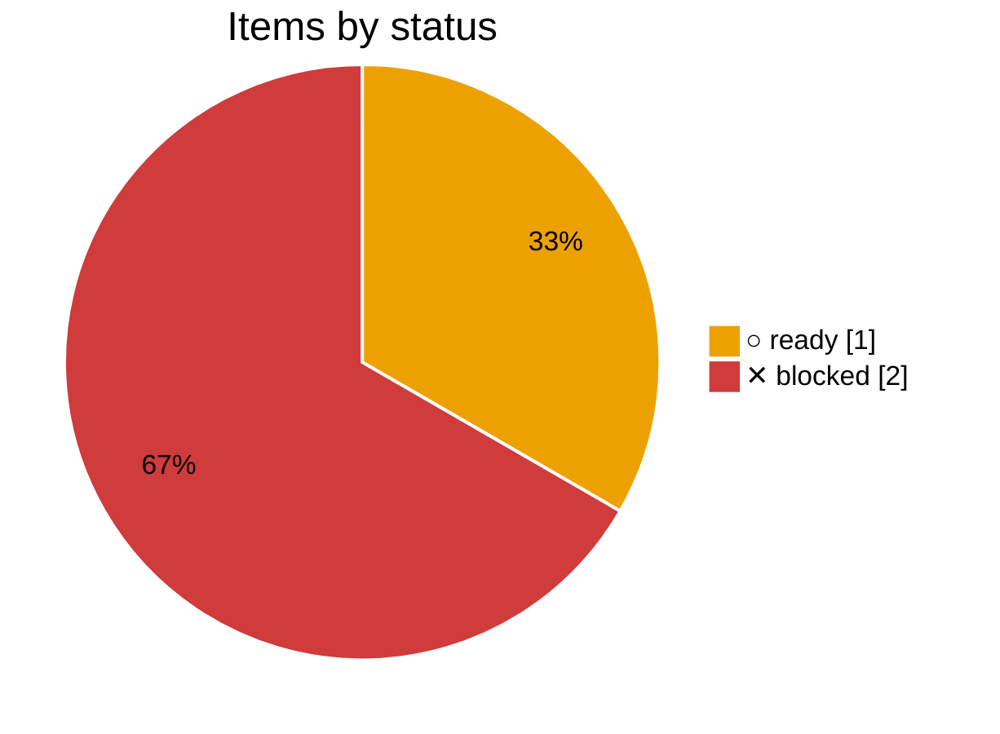
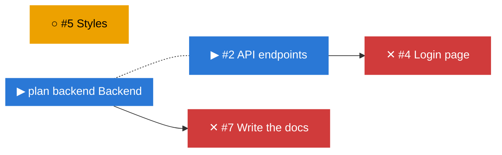

# ✕ Frontend

_Plan `frontend` · [doc](../docs/frontend.md) · data as of 2026-10-23 04:12 UTC · [all subsets](README.md)_

**0% done** · ✓ 0 done · ▶ 0 active · ○ 1 ready · ✕ 2 blocked

Depends on: ▶ [Backend](../docs/backend.md)

**✕ Blocked**, waiting on ▶ [Backend](../docs/backend.md)

| Item | Status | Ticked | Depends on |
|---|---|--:|---|
| [#5](https://github.com/bvraghav/pm-dummy/issues/5) Styles | ○ ready |  |  |
| [#4](https://github.com/bvraghav/pm-dummy/issues/4) Login page | ✕ blocked |  | ▶ #2 |
| [#7](https://github.com/bvraghav/pm-dummy/issues/7) Write the docs | ✕ blocked |  | ▶ plan backend |
| [#6](https://github.com/bvraghav/pm-dummy/issues/6) Old idea | – dropped |  |  |

## Changes

From 2026-10-23 03:44 to 2026-10-23 04:12 UTC:

- no changes

## Needs attention

### ✕ Blocked

- [#4](https://github.com/bvraghav/pm-dummy/issues/4) Login page, waiting on ▶ [#2](https://github.com/bvraghav/pm-dummy/issues/2) API endpoints
- [#7](https://github.com/bvraghav/pm-dummy/issues/7) Write the docs, waiting on ▶ [Backend](../docs/backend.md)

## Next up

- ○ [#5](https://github.com/bvraghav/pm-dummy/issues/5) Styles

## Dependency graph

_Legend: ✓ done · ▶ active (assigned or partly ticked) · ○ ready (nothing it waits on is open) · ✕ blocked · arrows point from a dependency to what waits on it; dotted lines join a plan to its items._

## Trend

_The trend starts once there are two days of history._
